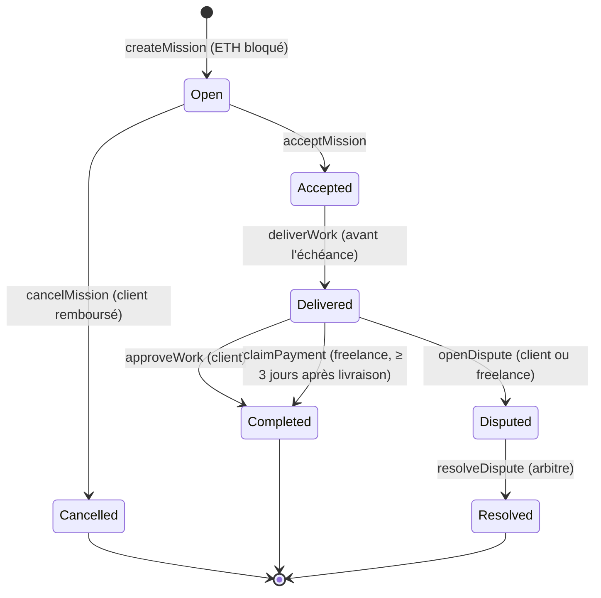

# LockPay

**Plateforme de séquestre (escrow) Ethereum pour les missions freelance étudiantes.** Projet Blockchain, IGL4.

Un client publie une mission et bloque le paiement en ETH dans un smart contract. Un étudiant freelance l'accepte, livre son travail (seule l'**empreinte** du livrable est inscrite on-chain) et il est payé quand le client approuve. En cas de désaccord, un arbitre répartit les fonds.

   

---

## Sommaire

1. [Rôles](#1-rôles)
2. [Cycle de vie d'une mission](#2-cycle-de-vie-dune-mission)
3. [Stockage on-chain / hors chaîne](#3-stockage-on-chain--hors-chaîne)
4. [Structure du projet](#4-structure-du-projet)
5. [Prérequis](#5-prérequis)
6. [Installation et lancement](#6-installation-et-lancement)
7. [Script de démonstration](#7-script-de-démonstration)
8. [Tests](#8-tests)
9. [Limites connues](#9-limites-connues)
10. [Sécurité](#10-sécurité)

Documentation complémentaire : [docs/architecture.md](docs/architecture.md) (architecture, cas d'utilisation, diagramme de séquence, comparatif centralisé / décentralisé).

---

## 1. Rôles

| Rôle | Qui | Peut… |
|---|---|---|
| **Arbitre** | L'adresse qui déploie le contrat (compte Hardhat #0) | Trancher un litige : `resolveDispute(id, partFreelanceBps)` |
| **Client** | Toute adresse qui crée une mission | Créer, annuler (si personne n'a accepté), approuver, ouvrir un litige |
| **Freelance** | Toute adresse qui accepte une mission, sauf le client | Accepter, livrer avant l'échéance, réclamer le paiement après 3 jours de silence, ouvrir un litige |

Les rôles sont **par mission** : un même étudiant peut être client d'une mission et freelance d'une autre.

## 2. Cycle de vie d'une mission



| Fonction | Qui | État requis | Effet sur les fonds |
|---|---|---|---|
| `createMission(title, descriptionHash, deadline)` payable | tout le monde | — | `msg.value` bloqué dans le contrat |
| `cancelMission(id)` | client | `Open` | remboursement intégral du client |
| `acceptMission(id)` | tout sauf le client | `Open` | — |
| `deliverWork(id, deliverableHash)` | freelance assigné | `Accepted`, avant `deadline` | — |
| `approveWork(id)` | client | `Delivered` | 100 % au freelance |
| `claimPayment(id)` | freelance | `Delivered` + 3 jours | 100 % au freelance |
| `openDispute(id)` | client ou freelance | `Delivered` | fonds gelés |
| `resolveDispute(id, bps)` | arbitre | `Disputed` | `bps / 10000` au freelance, le reste au client |

Événements émis : `MissionCreated`, `MissionCancelled`, `MissionAccepted`, `WorkDelivered`, `PaymentReleased`, `DisputeOpened`, `DisputeResolved`.

## 3. Stockage on-chain / hors chaîne

Écrire sur Ethereum coûte du gaz, et tout y est public. On n'y met donc que ce qui sert à **décider des paiements** et à **prouver** ce qui a été convenu.

| On-chain (contrat) | Hors chaîne |
|---|---|
| id, client, freelance, montant, statut | Texte complet de la description (localStorage du navigateur) |
| titre, échéance, date de livraison | Fichier livré (reste chez le freelance, transmis au client par un autre canal) |
| `descriptionHash` = keccak256(description) | |
| `deliverableHash` = keccak256(fichier ou texte) | |

Le hash est un **engagement** : si quelqu'un modifie la description ou le fichier, son hash ne correspond plus. L'interface le vérifie automatiquement (badge « Empreinte vérifiée ») et le client peut déposer le fichier reçu dans « Vérifier un fichier » pour le comparer au hash on-chain.

## 4. Structure du projet

```
contracts/LockPay.sol      Smart contract (NatSpec sur chaque fonction)
test/LockPay.test.js       23 tests mocha/chai (succès + rejets)
scripts/deploy.js             Déploie et écrit adresse + ABI dans frontend/src/contract.json
scripts/seed.js               Crée 2 missions de démonstration
hardhat.config.js             Config Hardhat 3 (solc 0.8.28, réseau localhost)
frontend/                     DApp Vite + JavaScript vanilla + ethers v6
  src/chain.js                Connexion au nœud, MetaMask, transactions, messages d'erreur
  src/offchain.js             Stockage hors chaîne + calcul des hash keccak256
  src/main.js                 État, rendu, actions, journal des événements
  src/i18n.js                 Textes de l'interface en français et en anglais
  src/format.js, icons.js     Formatage et icônes (Lucide)
  src/style.css               Styles
docs/architecture.md          Diagrammes Mermaid + comparatif
```

## 5. Prérequis

| Outil | Version testée | Remarque |
|---|---|---|
| Node.js | **22.17.0** (≥ 22.12 requis par Vite 8 et Hardhat 3) | `node -v` |
| npm | 11.6.2 | fourni avec Node |
| Hardhat | **3.22.0** | installé localement par `npm install` |
| Solidity (solc) | 0.8.28 | téléchargé automatiquement par Hardhat |
| ethers | 6.17.0 | |
| Vite | 8.3.8 | |
| OpenZeppelin Contracts | 5.6.1 | `ReentrancyGuard` uniquement |
| MetaMask | extension ≥ 12.x | Chrome, Edge, Brave ou Firefox |

## 6. Installation et lancement

### 6.1 Installer les dépendances

```bash
git clone https://github.com/IsmailMechkene/LockPay.git lockpay
cd lockpay
npm install
npm --prefix frontend install
```

### 6.2 Vérifier que tout fonctionne

```bash
npx hardhat test
```

Résultat attendu : `23 passing`.

### 6.3 Lancer la blockchain locale (terminal 1, à laisser ouvert)

```bash
npx hardhat node
```

Le nœud écoute sur `http://127.0.0.1:8545` (chainId **31337**) et affiche 20 comptes de test avec 10 000 ETH chacun.

### 6.4 Déployer le contrat (terminal 2)

```bash
npm run deploy     # = npx hardhat run scripts/deploy.js --network localhost
npm run seed       # optionnel : 2 missions de démonstration
```

Le script écrit l'adresse et l'ABI dans `frontend/src/contract.json`. Sur un nœud neuf, l'adresse est toujours `0x5FbDB2315678afecb367f032d93F642f64180aa3`.

### 6.5 Configurer MetaMask

**a) Ajouter le réseau local.** MetaMask → sélecteur de réseau → *Ajouter un réseau* → *Ajouter un réseau manuellement* :

| Champ | Valeur |
|---|---|
| Nom du réseau | Hardhat Local |
| URL RPC | `http://127.0.0.1:8545` |
| ID de chaîne | `31337` |
| Symbole | `ETH` |

L'application propose aussi un bouton « Passer sur Hardhat Local » qui fait cette étape automatiquement.

**b) Importer 3 comptes de test.** MetaMask → icône du compte → *Ajouter un compte* → *Importer un compte* → coller la clé privée. Ces clés sont affichées par `npx hardhat node` et sont **publiques** (identiques sur toutes les machines) :

| Rôle dans la démo | Compte | Adresse | Clé privée |
|---|---|---|---|
| Arbitre | #0 | `0xf39F…2266` | `0xac0974bec39a17e36ba4a6b4d238ff944bacb478cbed5efcae784d7bf4f2ff80` |
| Client | #1 | `0x7099…79C8` | `0x59c6995e998f97a5a0044966f0945389dc9e86dae88c7a8412f4603b6b78690d` |
| Freelance | #2 | `0x3C44…93BC` | `0x5de4111afa1a4b94908f83103eb1f1706367c2e68ca870fc3fb9a804cdab365a` |

> ⚠️ Ces clés sont connues de tout le monde. N'envoyez **jamais** de vrais fonds sur ces adresses, sur aucun réseau.

Renommez-les dans MetaMask (« Arbitre », « Client », « Freelance ») pour la soutenance. L'interface affiche aussi `#0`, `#1`, `#2` à côté des adresses.

### 6.6 Lancer le frontend (terminal 2)

```bash
npm run frontend   # = npm --prefix frontend run dev
```

Ouvrir l'URL affichée par Vite (en général `http://localhost:5173` ; si ce port est pris, Vite choisit le suivant), puis cliquer **Connecter MetaMask**.

Si quelque chose manque (nœud arrêté, contrat non déployé, MetaMask absent, mauvais réseau), un encadré **« Avant de commencer »** affiche la prochaine étape à faire et se coche tout seul quand elle est réglée. Le bouton **FR / EN** de la barre du haut change la langue de l'interface.

### Lire l'interface

- **À faire** (en haut de la liste) : les missions qui attendent une action du compte connecté, avec le bouton correspondant.
- Chaque ligne de mission donne son statut en une phrase (« Travail livré : validez-le ou ouvrez un litige · reste 2 j 23 h ») et, s'il y en a une, l'action principale juste en dessous. Cliquer sur la ligne déplie le détail : description, hash, échéances et actions secondaires (annuler, litige…).
- En haut à droite : le badge **Arbitre** pour le compte #0, sinon le nombre de missions où vous êtes client et freelance.

### Après un redémarrage du nœud

Un nœud Hardhat redémarré repart de zéro, mais MetaMask garde l'ancien compteur de transactions (nonce) :

1. relancer `npm run deploy` (et `npm run seed`) ;
2. dans MetaMask : *Paramètres → Avancé → Effacer les données de l'onglet activité*, pour chaque compte utilisé ;
3. recharger la page.

## 7. Script de démonstration

Préparation : nœud lancé, `npm run deploy` et `npm run seed` exécutés, frontend ouvert, les 3 comptes importés. Le **journal on-chain** (colonne de droite) affiche chaque événement au moment où il est miné.

### Scénario 1 : mission réussie

| # | Compte MetaMask | Action | Ce qu'on montre |
|---|---|---|---|
| 1 | Client (#1) | Formulaire : titre « Logo pour le club photo », une description, `0.5` ETH, échéance par défaut → **Bloquer les fonds et publier** | L'empreinte de la description se calcule en direct sous le champ. Le bandeau indique 0.5 ETH de plus en séquestre. Événement `MissionCreated`. |
| 2 | Client | Cliquer sur la ligne pour la déplier | Statut **Ouverte**, badge « Empreinte vérifiée » : le texte local correspond au hash on-chain. |
| 3 | Freelance (#2) | **Accepter** (sous la phrase de statut) | Statut **Acceptée**, `MissionAccepted`. |
| 4 | Freelance | **Livrer le travail** (sur la ligne, ou dans « À faire ») → onglet *Fichier* → choisir un fichier quelconque → **Envoyer l'empreinte** | Le hash keccak256 du fichier s'affiche avant l'envoi : le fichier ne quitte pas le navigateur. `WorkDelivered`. |
| 5 | Client | **Vérifier un fichier** → déposer le même fichier, puis un autre | « Identique au hash on-chain » puis « Différent ». |
| 6 | Client | **Approuver et payer**, depuis l'encadré « À faire » | Statut **Payée**, `PaymentReleased`, le solde du freelance augmente de 0.5 ETH dans MetaMask. |

### Scénario rejeté 1 : un client accepte sa propre mission

| # | Compte | Action | Résultat attendu |
|---|---|---|---|
| 1 | Client (#1) | Activer **Mode démo** (en haut de la liste) | Les actions normalement masquées apparaissent en pointillés. |
| 2 | Client | Déplier une mission **Ouverte** qu'il a créée → **Accepter** (bouton en pointillés) | Encadré rouge **« Transaction rejetée par le contrat »** avec `revert "Client cannot accept own mission"`. |

À dire au jury : *ce n'est pas l'interface qui bloque, c'est le contrat.* Le mode démo retire les filtres de l'UI, et le `require` de `acceptMission` refuse quand même. Avant d'ouvrir MetaMask, l'application simule la transaction (`eth_call`) pour récupérer le message exact.

### Scénario rejeté 2 : réclamer le paiement trop tôt

| # | Compte | Action | Résultat attendu |
|---|---|---|---|
| 1 | Freelance (#2) | Mission seedée « Affiche JPO » (déjà acceptée) → **Livrer le travail** (onglet *Texte*, n'importe quel texte) | Statut **Livrée**, la ligne indique « En attente de validation · réclamation possible dans 3 j 0 h ». |
| 2 | Freelance | Déplier la mission → **Réclamer le paiement** | Encadré rouge `revert "Review period not over"`. |
| 3 | — | Barre du haut : **+3 jours** (avance l'horloge du nœud local avec `evm_increaseTime`) | Horloge de la chaîne avancée, la ligne indique « Période de revue écoulée ». |
| 4 | Freelance | **Réclamer le paiement**, qui apparaît maintenant sur la ligne et dans « À faire » | Succès : `PaymentReleased` avec la mention « réclamation après 3 jours ». |

### Rejets supplémentaires, si le jury en demande

| Rejet | Comment le provoquer | Message |
|---|---|---|
| Montant nul | Formulaire avec `0` ETH | `Amount must be > 0` |
| Échéance passée | Formulaire avec une date d'hier | `Deadline must be in the future` |
| Double paiement | Mode démo, déplier une mission **Payée** → **Approuver et payer** | `Invalid state` |
| Non-arbitre qui tranche | Litige ouvert, compte Client, mode démo → **Arbitrer** | `Only arbiter` |
| Arbitrage 50/50 | Litige ouvert, compte Arbitre (#0) → **Arbitrer** → 50 % | `DisputeResolved` et chacun reçoit la moitié |
| Signature refusée | Cliquer *Refuser* dans MetaMask | « Signature refusée » |

## 8. Tests

```bash
npx hardhat test
```

23 tests dans [test/LockPay.test.js](test/LockPay.test.js), qui utilisent `loadFixture` (chaque test repart d'un instantané propre) et `time.increase` pour simuler le passage du temps.

| Catégorie | Tests |
|---|---|
| Succès | flux complet create → accept → deliver → approve (soldes + événements), annulation et remboursement, réclamation après 3 jours, litige 50/50, litige 0 %, litige ouvert par le freelance |
| Rejets demandés | montant nul, échéance passée, client qui accepte sa mission, inconnu qui livre, livraison après l'échéance, inconnu qui approuve, réclamation avant 3 jours, non-arbitre qui tranche, double paiement |
| Rejets en plus | hash de livrable vide, annulation après acceptation, annulation par un inconnu, part > 10 000 bps, litige ouvert par un inconnu, double arbitrage, mission inexistante |

## 9. Limites connues

- **Arbitre de confiance.** L'arbitre est une seule adresse, fixée au déploiement. Il peut être partial ou perdre sa clé. Pistes : un multisig, un vote de plusieurs arbitres, ou un protocole d'arbitrage décentralisé comme Kleros.
- **La qualité du travail n'est pas vérifiable on-chain.** Le contrat prouve *quel* fichier a été livré et *quand*, pas qu'il est bon. Le jugement reste humain : client, puis arbitre.
- **Mission acceptée puis abandonnée.** Si le freelance accepte sans jamais livrer, les fonds restent bloqués (`cancelMission` n'est possible qu'en `Open`). Amélioration simple : permettre au client de récupérer les fonds quand l'échéance est dépassée sans livraison.
- **Le freelance ne peut pas ouvrir de litige avant de livrer.** Un client de mauvaise foi peut aussi ouvrir un litige sur chaque livraison pour retarder le paiement.
- **Coûts de gaz.** Chaque action coûte des frais. Ils sont négligeables en local, mais sur le mainnet ils peuvent dépasser le prix d'une petite mission étudiante. Un réseau de couche 2 (Arbitrum, Optimism, Base) les réduirait fortement.
- **Volatilité de l'ETH.** Le montant est fixé en ETH, pas en euros : sa valeur peut varier entre la création et le paiement. Une version avec stablecoin (USDC) réglerait ce point, mais le sujet exclut les ERC-20.
- **Stockage hors chaîne local.** Les descriptions sont dans le `localStorage` d'un seul navigateur. En production, il faudrait IPFS ou un serveur, le hash on-chain garantissant toujours l'intégrité.
- **Confidentialité.** Titres, montants et adresses sont publics sur la blockchain.

## 10. Sécurité

- **Comptes de test uniquement.** Les clés Hardhat ci-dessus sont publiques. N'utilisez jamais votre portefeuille personnel pour la démo, et créez de préférence un profil de navigateur dédié avec MetaMask.
- **Ne jamais committer de clé privée ni de phrase de récupération.** Si un déploiement sur testnet est ajouté plus tard, utilisez un fichier `.env` (ignoré par git) ou `npx hardhat keystore set`.
- Le [.gitignore](.gitignore) exclut `node_modules/`, `.env`, `artifacts/`, `cache/` et les fichiers générés (`frontend/src/contract.json`, `frontend/public/offchain-seed.json`).
- Mesures dans le contrat : modificateurs de rôle et d'état, checks-effects-interactions (le statut change avant tout transfert), `ReentrancyGuard` d'OpenZeppelin sur les fonctions qui envoient de l'ETH, et états finaux qui rendent un double paiement impossible. Le détail est dans [docs/architecture.md](docs/architecture.md#6-sécurité-du-contrat-en-bref).
