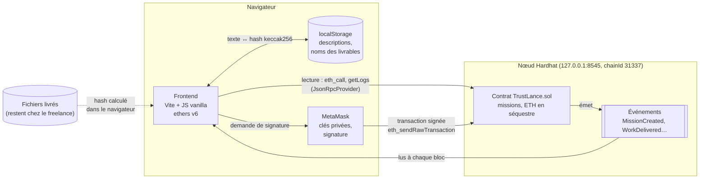
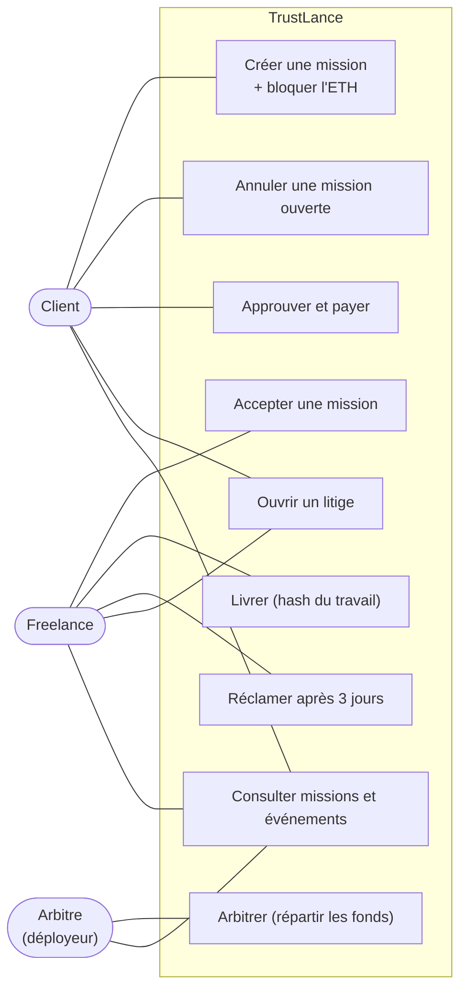
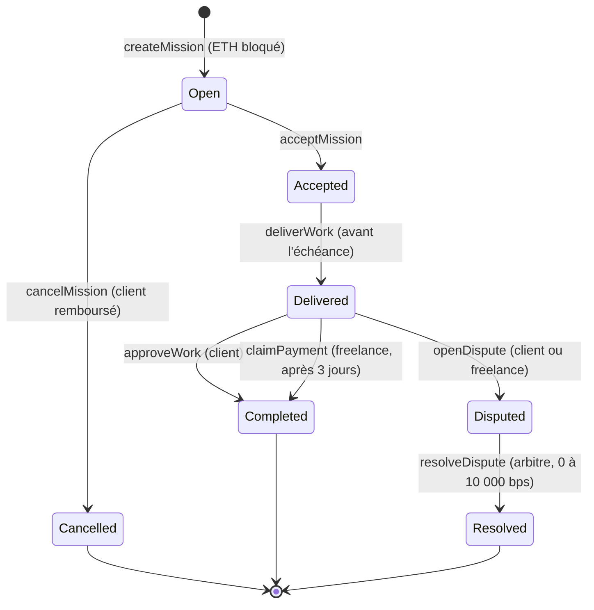
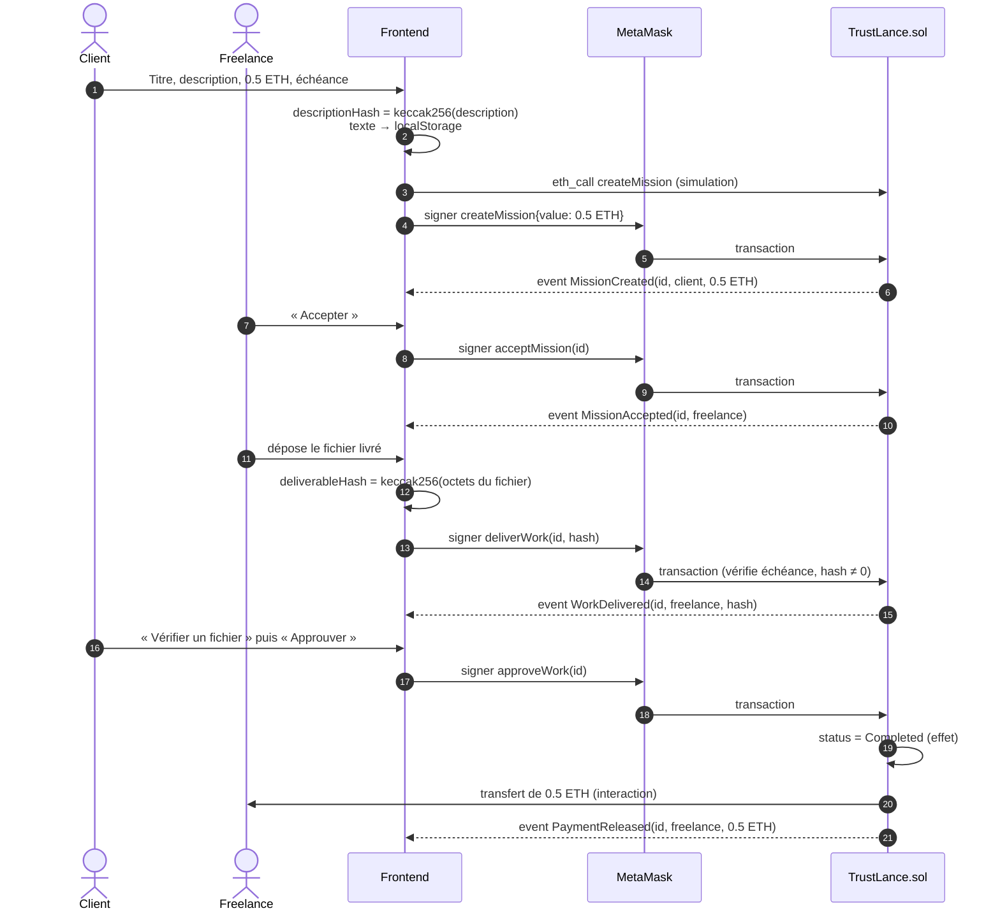

# Architecture de TrustLance

Ce document décrit comment les morceaux de la DApp s'emboîtent : qui parle à qui, ce qui est stocké où, et comment se déroule une mission de bout en bout.

## 1. Vue d'ensemble

Points clés :

- **Lecture** : le frontend lit le contrat directement via le nœud (`JsonRpcProvider`). Cela fonctionne même sans MetaMask connecté.
- **Écriture** : chaque action est d'abord **simulée** (`eth_call` depuis l'adresse de l'utilisateur). Si le contrat refuserait, on affiche son message `require` exact. Sinon, MetaMask signe la vraie transaction.
- **Journal** : à chaque nouveau bloc, le frontend récupère les événements du contrat (`queryFilter`) et met la liste des missions à jour.

## 2. Stockage on-chain / hors chaîne

| Donnée | Où | Pourquoi |
|---|---|---|
| Montant en ETH, statut, adresses client / freelance / arbitre | **On-chain** (contrat) | Doit être infalsifiable : c'est ce qui décide des paiements. |
| Titre, échéance, date de livraison | **On-chain** | Court, utile pour lister les missions et pour les règles de délai. |
| `descriptionHash` (32 octets) | **On-chain** | Engagement : prouve quel texte a été accepté, sans le publier. |
| Texte complet de la description | **Hors chaîne** (localStorage) | Long donc cher en gaz, et potentiellement privé. |
| `deliverableHash` (32 octets) | **On-chain** | Preuve horodatée de ce qui a été livré. |
| Fichier livré | **Hors chaîne** (chez le freelance, envoyé au client par un autre canal) | Un fichier peut peser des Mo : impossible à stocker on-chain. |

Le lien entre les deux mondes est la fonction **keccak256** : n'importe qui peut re-hacher un texte ou un fichier et vérifier qu'il correspond au hash enregistré. L'interface le fait automatiquement (« Empreinte vérifiée ») et propose « Vérifier un fichier » pour le livrable.

## 3. Cas d'utilisation

Une même adresse peut être client d'une mission et freelance d'une autre. Seule contrainte : on ne peut pas accepter sa propre mission.

## 4. Machine à états d'une mission

`Completed`, `Cancelled` et `Resolved` sont des états finaux : aucune fonction de paiement n'accepte ces états. C'est ce qui rend un double paiement impossible.

## 5. Séquence du scénario principal

## 6. Sécurité du contrat, en bref

| Mesure | Où dans le code |
|---|---|
| Contrôle des rôles par modificateurs | `onlyClient`, `onlyFreelancer`, `onlyParties`, `onlyArbiter` |
| Contrôle des états | `inStatus(id, Status.X)` sur chaque fonction |
| Checks-Effects-Interactions | le statut change **avant** l'appel `_send` |
| Anti-réentrance | `nonReentrant` (OpenZeppelin `ReentrancyGuard`) sur toutes les fonctions qui envoient de l'ETH |
| Aucun wei perdu à l'arbitrage | `clientAmount = amount - freelancerAmount` |
| Arbitre immuable | `address public immutable arbiter`, fixé au déploiement |

## 7. Centralisé vs décentralisé

| Critère | Plateforme centralisée (type Malt, Fiverr) | TrustLance (contrat Ethereum) |
|---|---|---|
| Garde des fonds | La plateforme détient l'argent sur son compte bancaire | Le contrat détient l'ETH ; personne ne peut le déplacer hors des règles codées |
| Règles de paiement | Conditions générales, modifiables par la plateforme | Code public et immuable une fois déployé |
| Confiance requise | Envers l'entreprise (solvabilité, honnêteté, support) | Envers le code et, uniquement en cas de litige, envers l'arbitre |
| Transparence | Historique visible seulement par la plateforme | Chaque action est un événement public et horodaté |
| Commission | 10 à 20 % en général | Seulement les frais de gaz |
| Litiges | Service client, procédure interne | Arbitre unique (limite connue, voir README) |
| Censure / gel de compte | Possible à tout moment | Impossible sur une mission déjà financée |
| Confidentialité | Données privées chez la plateforme | Données on-chain publiques ; d'où le stockage hors chaîne des textes |
| Expérience utilisateur | Carte bancaire, e-mail | Portefeuille, gestion des clés, volatilité de l'ETH |
| Réversibilité d'une erreur | Remboursement possible par le support | Transaction définitive |
